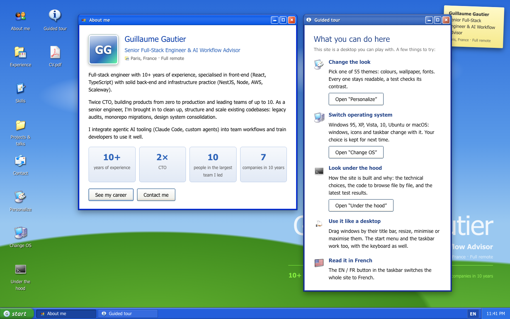
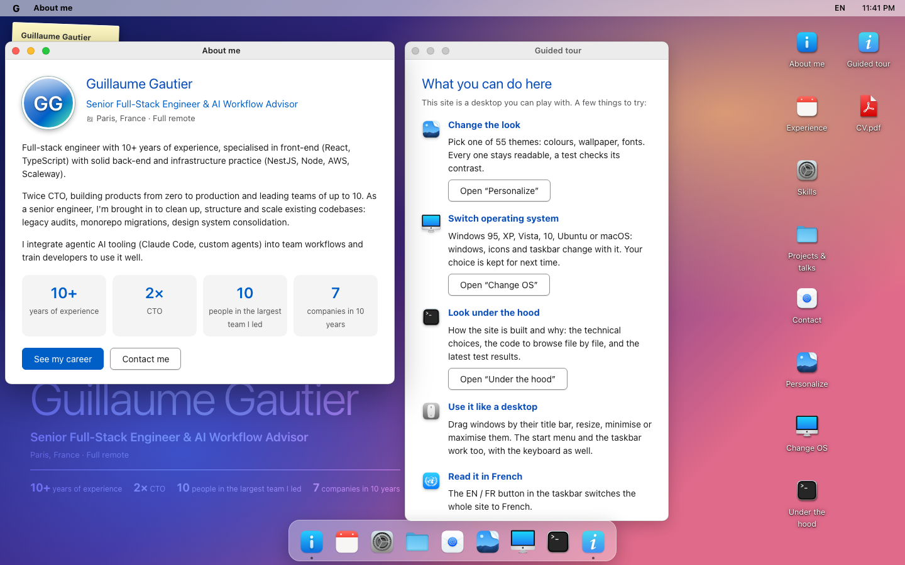
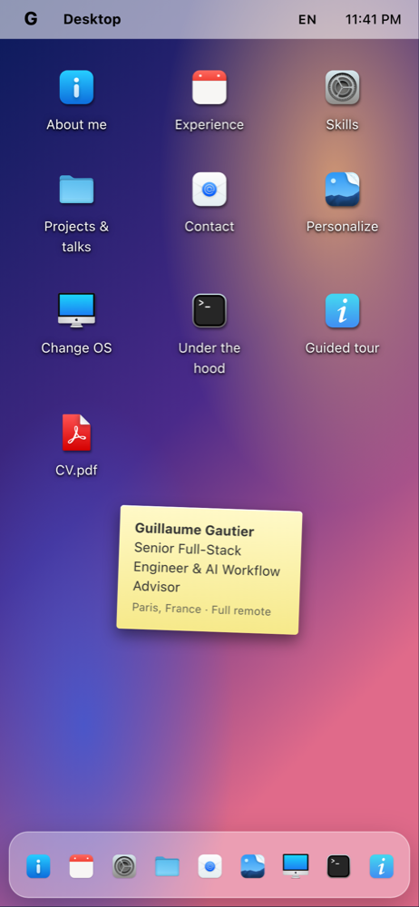
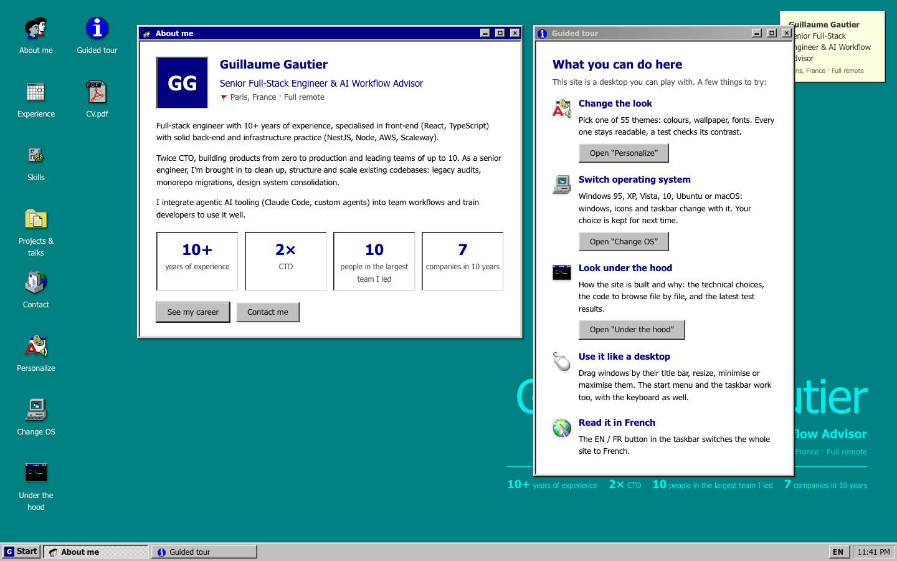
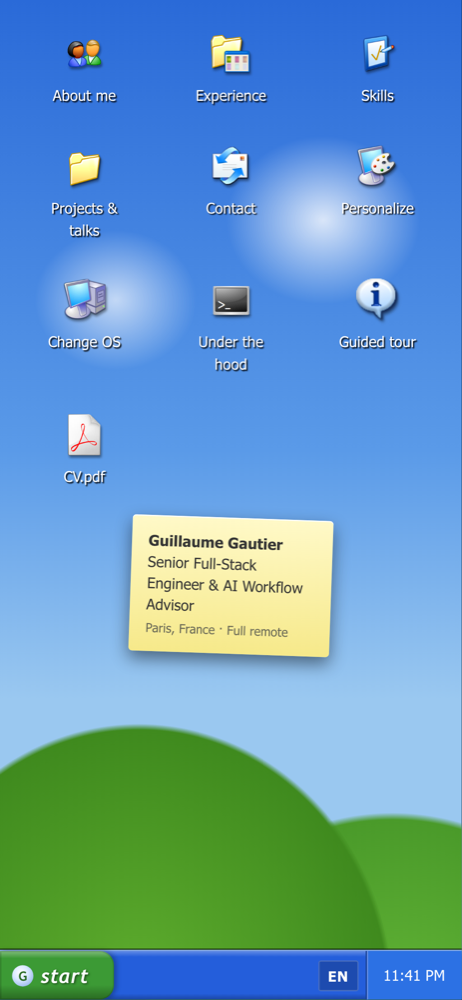

# Guillaume Gautier · a portfolio that boots like a computer

My resume, as a desktop you can play with. Windows open, move, resize and minimise, there's a start menu and a
taskbar, and you choose the computer: **Windows 95, XP, Vista, 10, Ubuntu or macOS**, with **55 themes** between
them. In English or French, on a desktop or a phone.



<table>
  <tr>
    <td width="62%"></td>
    <td></td>
  </tr>
  <tr>
    <td></td>
    <td></td>
  </tr>
</table>

## What you can do on it

- **Read the resume**: about me, experience (company by company), skills, projects & talks, contact, and the
  PDF version.
- **Change the look**: Personalize lists every theme of the current system, each one with a live preview.
- **Change the computer**: Change OS switches the windows, icons, taskbar and fonts, and replays the boot
  screen. The choice is remembered.
- **Look under the hood**: an app inside the site explains every technical choice and points at it on screen
  ("Show me"), lets you browse the source code file by file, and shows the latest test results.
- **Use it with a keyboard or a screen reader**: everything is reachable, focus moves into what opens, `Escape`
  closes menus.

A **Guided tour** window opens next to *About me* on start, to show all of this.

## How it's built

| | |
|---|---|
| **Stack** | React 19, TypeScript 7, Vite 8. A static site, no server. |
| **Dependencies** | Two at runtime: `react` and `react-dom`. Window manager, themes, i18n, contrast maths and storage are written by hand, a few dozen lines each. |
| **Design system** | Three layers, each one only talking to the one below: **palettes** (one file per OS, a theme only lists what it changes), **tokens** (one CSS file per OS family: bevels, Luna, glass, flat, GNOME, macOS), **components** that only read tokens and never know which OS they're on. |
| **Icons** | Real open-source icon themes, one per OS (Chicago95, B00merang, Yaru, WhiteSur), fetched and mapped by a script. |
| **Accessibility** | WCAG 2.2 AA on every theme. Theme colours are nudged until they're readable (`readable()`), then checked by a unit test and by axe-core on every theme × every app, desktop and mobile. |
| **Tests** | Vitest for the logic (geometry, contrast, content rules), Playwright for everything a visitor does, desktop and phone. Every bug fix ships with the test that would have caught it. |

```
src/
├── App.tsx            composition root: the whole site, top to bottom, in one file
├── apps/              one component per window (About, Experience, Under the hood…)
├── content/           every string visitors read, in English and French (fr.ts is typed by en.ts)
├── design-system/     themes → chromes (tokens) → components, behind one entry point
└── hooks/             window manager, language, theme selection
e2e/                   Playwright tests, axe-core included
docs/                  technical choices and accessibility, in depth (French)
```

## Run it

```bash
npm install
npm run dev          # http://localhost:5173
npm run build        # static site in dist/
```

## Check it

```bash
npm run lint         # oxlint, accessibility rules included
npm test             # unit tests (Vitest)
npm run test:e2e     # end-to-end + axe-core (Playwright, builds the site first)
```

## Go further

- [`docs/CHOIX-TECHNIQUES.md`](docs/CHOIX-TECHNIQUES.md): every technical choice, why, how, and what was left out (French)
- [`docs/ACCESSIBILITE.md`](docs/ACCESSIBILITE.md): the WCAG 2.2 AA approach and its known limits (French)
- [`src/design-system/README.md`](src/design-system/README.md): how to add a theme, an OS or an icon

## Credits

Icons come from open-source icon themes, each under its own license: see
[`src/design-system/icons/CREDITS.md`](src/design-system/icons/CREDITS.md). Windows and macOS are trademarks of
their owners. This site imitates their look as a tribute and has no link with them.

Contact: [gg-xeewi@pm.me](mailto:gg-xeewi@pm.me) · [LinkedIn](https://www.linkedin.com/in/gautierg) · [GitHub](https://github.com/xeewi)
